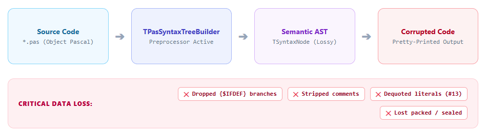
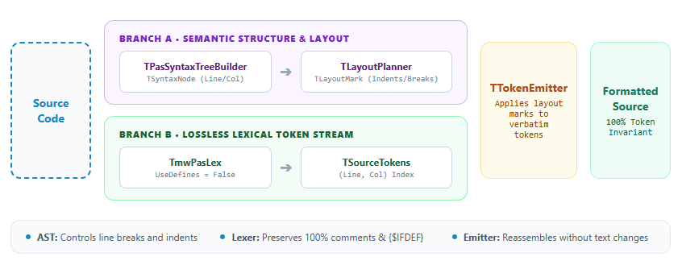
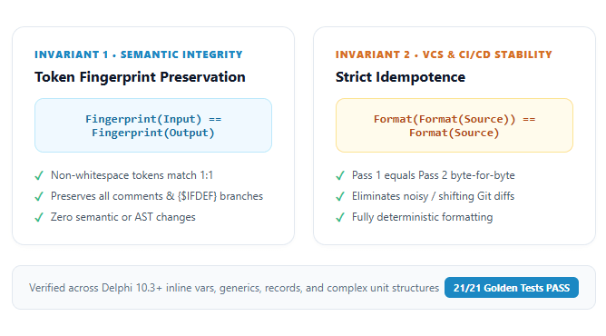

# Why AST Alone Fails: Building Lossless Code Tools in Delphi

In codebases with a long history, inconsistent formatting is a persistent drag on developer velocity. Some units use two-space indentation while others use four, `begin..end` blocks are scattered across random styles, and multiline conditional statements obscure business intent. The natural engineering impulse is automation: build a command-line tool to format code cleanly before commits or integrate it directly into a CI/CD pipeline.

In the Delphi world, the first intuitive choice for this task is the popular [DelphiAST](https://github.com/romanyankovsky/delphiast) library. The recipe appears straightforward:
1. Load a `.pas` source file.
2. Parse it into a `TSyntaxNode` syntax tree.
3. Walk the tree and regenerate the source code with consistent indentation (*AST-to-Source*).

However, attempting to deploy this approach in a production Delphi project leads almost immediately to catastrophe.

---

## The Naive Formatter Trap

Imagine running such a newly minted formatter on a critical production unit. The resulting formatted code looks polished: indentation is aligned, and keywords adhere strictly to style guidelines. Then, the CI build runs, and the compiler fails unexpectedly.

When you inspect the Git diff, the problem becomes terrifyingly clear:
- All `{$IFDEF}` compiler directives have evaporated—the parser baked in only the active branch, and platform-specific code for other targets has vanished.
- Every comment documenting complex algorithms and business rules is gone.
- A `packed record` declaration was re-emitted as a plain `record`, silently breaking binary struct alignment in memory.
- Character literals like `#13` were converted to string literals `'#13'`, breaking byte and string semantics.



Why did this happen? Is it a bug in the parser implementation?

No. It is a fundamental design characteristic of compiler frontends. To understand why, a medical analogy is helpful: **the X-ray metaphor**.

> **The X-Ray Metaphor:** An AST tree is like an X-ray photograph of a human being. An X-ray reveals the skeleton, bone structure, and anatomical proportions with high fidelity. But attempting to "reconstruct a living human" from an X-ray alone yields a lifeless skeleton stripped of skin, muscles, eye color, and facial expression. In source code, those vital "soft tissues" are comments, preprocessor directives, whitespace, and precise literal representations.

---

## Problem Anatomy: Why Delphi AST is Lossy

In compiler theory, there is a fundamental distinction between two types of syntax trees:
1. **Concrete Syntax Tree (CST / Parse Tree):** A lossless, high-fidelity tree representing every single character, space, bracket, comment, and lexical token in the source file.
2. **Abstract Syntax Tree (AST):** A semantic tree that intentionally discards details irrelevant to runtime execution, focusing strictly on high-level program logic.

The `DelphiAST` library is a classic semantic tree (*Lossy AST*). It was engineered for static analysis, code navigation, and type inspection—not for lossless round-trip code regeneration.

An in-depth analysis of the library codebase (documented in the project repository in [01-analiza-delphiast.md](https://github.com/bogdanpolak/rzemieslnik-kodu/blob/master/delphi-formatter/docs/01-analiza-delphiast.md)) reveals four concrete reasons why a direct *AST-Writer* cannot safely format Object Pascal:

### 1. Preprocessor Evaluation Drops Inactive Branches
By default, the lexer operates with `UseDefines = True`. The preprocessor evaluates conditionals such as `{$IFDEF MSWINDOWS}` or `{$IFDEF DEBUG}`. Code in inactive branches is discarded as dead text and never reaches the parser. Once parsed, the inactive code no longer exists in memory. It cannot be reconstructed from the AST.

### 2. Comments Live Outside the Syntax Tree
Comment nodes (`TCommentNode`) are not part of the `TSyntaxNode` hierarchy. The parser collects them into an auxiliary list on the builder, and comments located inside inactive preprocessor blocks are skipped entirely. The AST tree does not retain knowledge of which statement or expression a comment belongs to.

### 3. Dequoted Literals
Both the string literal `'#13'` and the raw character code `#13` are represented in an `ntLiteral` node with identical string attribute data: `Value = '#13'`. The parser drops the lexical distinction between character codes and strings.

### 4. Missing Keywords and Language Modifiers
`TSyntaxNode` instances do not store many Delphi-specific language modifiers: `packed`, `class sealed`, `class abstract`, anonymous method `reference to` constructs, `class var` member visibility specifiers, and the contents of inline assembly blocks (`asm..end`).

**Conclusion:** Building an automated formatter on top of pure AST alone is an architectural dead end.

---

## The Hybrid Architecture Pattern (Variant C)

Since AST alone loses code, and a standalone lexer lacks awareness of block hierarchies and `begin..end` nesting, the solution is strict decoupling across two sources of truth. In the **[Code Craftsman (rzemieslnik-kodu)](https://github.com/bogdanpolak/rzemieslnik-kodu)** project, we formulated this solution as **Variant C – The Hybrid Architecture**.

The separation of concerns is absolute:
* **The AST Tree (`TPasSyntaxTreeBuilder`)** is responsible **solely for layout and geometry**: it decides where lines break, how deeply a `try..finally` block is indented, and how `if..else` ladders are aligned. It has no authority over text content.
* **The Lexer (`TmwPasLex` with `UseDefines = False`)** is responsible **solely for text content**: it provides a complete, lossless stream of lexical tokens containing 100% of keywords, comments, whitespace, and preprocessor directives.



The hybrid pipeline consists of four cooperating components:

1. **`TPasSyntaxTreeBuilder` (Branch A):** Parses the semantic AST, capturing opening and closing line and column positions (`Line`, `Col`, `EndLine`, `EndCol`) for every syntax construct.
2. **`TSourceTokens` (Branch B):** Executes a secondary lexer pass via `TmwPasLex` with preprocessor evaluation disabled (`UseDefines := False`). It indexes all tokens into a lookup map: `(Line, Col) -> TokenIndex`.
3. **`TLayoutPlanner` (Layout Planner):** Traverses AST nodes and attaches non-destructive layout annotations (`TLayoutMark`) to tokens: `BreakBefore` (newline), `Indent` (indentation depth), and `BlankBefore` (mandatory blank line).
4. **`TTokenEmitter` (Emitter):** Iterates through tokens in original source order, applying calculated indentation, stripping original whitespace, and normalizing operator spacing—**without altering a single input token**.

---

## Pipeline Implementation Step by Step

Here is the clean orchestration pipeline from `docs/Example.FormatterArchitecture.pas` in the repository:

```pascal
unit Example.FormatterArchitecture;

interface

function Run(const ASourceCode: string): string;

implementation

uses
  DelphiAST.Classes,
  DelphiAST.Lexer,
  DelphiAST.Formatter.Engine;

function Run(const ASourceCode: string): string;
var
  Root: TSyntaxNode;
  Tokens: TSourceTokens;
  Planner: TLayoutPlanner;
  Marks: TTokenMarks;
  Emitter: TTokenEmitter;
begin
  // Step 1: Parse the semantic AST to compute structure and layout
  Root := ParseSource(ASourceCode);
  try
    // Step 2: Extract the complete, lossless lexical token stream
    Tokens := TSourceTokens.Create(ASourceCode);
    try
      // Step 3: Compute line breaks and indentation marks from the AST
      Planner := TLayoutPlanner.Create(Tokens);
      try
        Marks := Planner.Plan(Root);
      finally
        Planner.Free;
      end;

      // Step 4: Emit formatted code, preserving every original token
      Emitter := TTokenEmitter.Create(Tokens, Marks);
      try
        Result := Emitter.Emit;
      finally
        Emitter.Free;
      end;
    finally
      Tokens.Free;
    end;
  finally
    Root.Free;
  end;
end;

end.
```

Notice the disciplined memory ownership model. In Object Pascal, `TSyntaxNode` instances form an ownership tree—freeing the root via `Root.Free` safely and recursively disposes of all child nodes.

### The Acid Test: Preprocessor Directives

How does the hybrid architecture handle code heavily populated with compiler directives? Consider this example from `docs/demo2_compiler_dir.pas`:

```pascal
unit demo2_compiler_dir;

{$IFDEF FPC}{$MODE DELPHI}{$ENDIF}
{$DEFINE SOMETHING}

interface

implementation

procedure Test;
begin
  {$IFDEF SOMETHING}
    Writeln('x1'); Writeln('x2'); 
  {$ELSE}
    Writeln('y1');      Writeln('y2'); 
  {$ENDIF}
end;

end.
```

In a pure AST approach, the `{$ELSE}` branch is permanently deleted. In the hybrid architecture:
1. `TSourceTokens` captures every token from both branches.
2. The active branch (`{$IFDEF SOMETHING}`) corresponds to AST nodes, so `TLayoutPlanner` grants it full structural formatting (one statement per line, properly indented).
3. The inactive branch (`{$ELSE}`) has no matching AST nodes, so the emitter engages a safe fallback: tokens are re-emitted with the relative indentation of the opening directive.
4. **Not a single character of code is lost.**

---

## Engineering Trust: Two Safety Invariants

Why are software engineers hesitant to adopt automated formatting tools in legacy codebases? Because they fear silent regressions. A displaced semicolon, a dropped parenthesis, or a missing compiler flag can bring production down. Traditional unit tests with a handful of `Assert.AreEqual` checks cannot guarantee safety across thousands of edge cases.

In the *Code Craftsman* project, we adopted **Invariant-Driven Design**. We defined two mathematical invariants that the formatter must satisfy unconditionally.



### Invariant 1: Token Fingerprint Preservation

We define the lexical hash function `TokenFingerprint(S)` as the concatenation of all significant semantic tokens (keywords, identifiers, operators, comments, and compiler directives), filtering out whitespace (`#32`, `#9`, `#10`, `#13`).

The invariant states:
$$\text{TokenFingerprint}(\text{Input}) = \text{TokenFingerprint}(\text{Formatted})$$

If the input code contains one hundred tokens, the formatted output must contain exactly those same one hundred tokens in identical sequence. The formatter is allowed to alter whitespace and layout—nothing else. This invariant is verified automatically on every run.

### Invariant 2: Strict Idempotence

What happens when you run a formatter on code that has already been formatted? An unstable tool might push indentation two spaces further with each run or shift comments around. In Git, that causes noisy, shifting diffs that pollute code reviews.

A professional formatter must be strictly idempotent:
$$\text{Format}(\text{Format}(S)) = \text{Format}(S)$$

The output of the second pass must match the output of the first pass down to the byte. In the repository, we built a diagnostic runner (`docs/demo3_idempotent.dpr`) that verifies this property and pinpoint-locates the exact character position of any deviation:

```pascal
function Test_Idempotent(AInput: string): TResult;
var
  Formatter: TDelphiCodeFormatter;
begin
  Result.Passed := False;
  Formatter := TDelphiCodeFormatter.Create;
  try
    Result.Actual := NormalizeLineEndings(Formatter.FormatSource(AInput));
    Result.Again  := NormalizeLineEndings(Formatter.FormatSource(Result.Actual));
    
    if Result.Actual = Result.Again then
    begin
      Result.Passed := True;
      Result.Report := 'Formatting IS idempotent: Format(Format(S)) = Format(S)';
    end
    else
    begin
      Result.Passed := False;
      Result.Report := 'Formatting IS NOT idempotent! (' +
        FirstDifference(Result.Again, Result.Actual) + ')';
    end;
  finally
    Formatter.Free;
  end;
end;
```

Engine stability is further reinforced by a suite of 21 **Golden Master** snapshot tests in `delphi-formatter/tests/golden/`, covering constructs from basic units and generics to modern Delphi 10.3+ inline variables (`var X := 10;`).

---

## Summary and Craftsmanship Heuristics

Software craftsmanship teaches us that developer tooling should build confidence, not create anxiety. Taking shortcuts by regenerating code directly from pure AST is a trap that has caught many tool authors.

Here is a quick decision heuristic when designing Object Pascal code tools:

| Task Type | Recommended Architecture | Rationale |
|---|---|---|
| **Static Analysis (Read-Only)** | Pure AST (`TPasSyntaxTreeBuilder`) | Semantic model is sufficient; lost comments and whitespace are irrelevant. |
| **Code Generation (From Scratch)** | Template Generator / CodeDOM | Emitting fresh files means there are no existing directives or comments to preserve. |
| **Formatting, Linting with Auto-Fix, Syntax Migration** | **Hybrid Architecture (AST + Lexer)** | **The only safe option.** Requires 100% preservation of developer intent and zero token loss. |

Craftsmanship in Delphi is about pragmatic engineering: understanding the limitations of existing libraries and wrapping them in robust architectures that deliver mathematical safety. The hybrid approach unites the power of compiler theory with the realities of production code.

---

## References and Further Reading

* **Project Repository:** [github.com/bogdanpolak/rzemieslnik-kodu](https://github.com/bogdanpolak/rzemieslnik-kodu) – complete implementation of the `dfmt` CLI engine, golden test suites, and VCL AST visualizer.
* **DelphiAST Library:** [github.com/romanyankovsky/delphiast](https://github.com/romanyankovsky/delphiast) – AST parser for Object Pascal by Roman Yankovsky.
* Robert C. Martin – *Clean Code: A Handbook of Agile Software Craftsmanship*, Prentice Hall 2008 (Chapter 5: *Formatting*).
* Martin Fowler – *Refactoring: Improving the Design of Existing Code*, Addison-Wesley 2018 (behavior-preserving transformations).
* Alfred V. Aho, Monica S. Lam, Ravi Sethi, Jeffrey D. Ullman – *Compilers: Principles, Techniques, and Tools* (lexical analysis vs. concrete syntax vs. semantic trees).
* Michael Feathers – *Working Effectively with Legacy Code*, Prentice Hall 2004 (characterization and golden master testing techniques).
